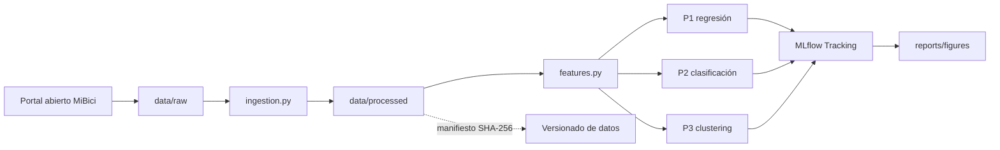

# Arquitectura propuesta

La ejecución local usa Python, pandas y scikit-learn. MLflow conserva
parámetros, métricas, tags y artefactos; Git conserva código y documentación;
el manifiesto `references/data_manifest.csv` conserva la versión verificable de
los CSV mediante filas, tamaños y hashes SHA-256, sin incluirlos directamente
en GitHub.
