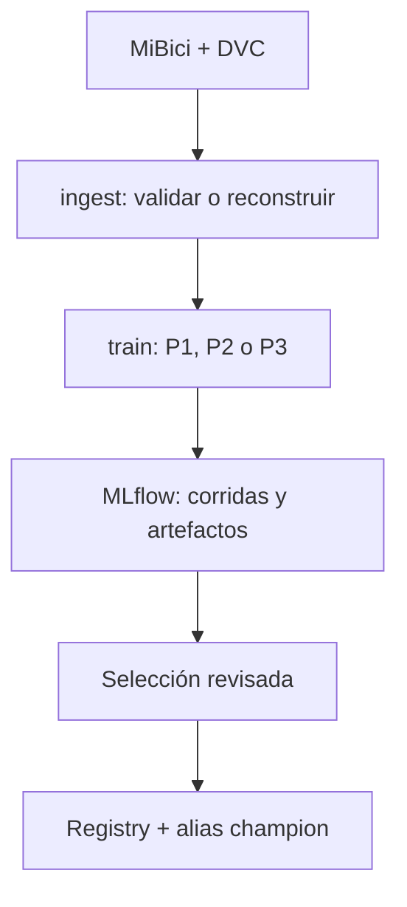

# Propuesta de integración del Equipo 23 — MLflow Projects y Model Registry

## Decisión común

Implementamos tres entradas de MLflow Projects (`ingest`, `train`, `search`)
con un parámetro `question=P1|P2|P3` y modelos explícitos. Todas las nuevas
corridas se consultan en el experimento `mibici-equipo23-mlprojects`. Los
experimentos anteriores de P1, P2 y P3 siguen existiendo con sus nombres
históricos; no se cambiaron sus resultados. Cada integrante puede revisar la
interfaz y proponer cambios mediante PR antes de integrar.

`python_env.yaml` declara dependencias fijadas y `uv.lock` resuelve el entorno
del equipo. `dvc.yaml` incluye tres etapas P2 nuevas, con fechas fijas y
archivos corregidos. La materialización de `dvc.lock`/cache y su carga a GCS
requieren ejecución desde un entorno con los datos y permisos.

## Estado comprobado de P2

- Observación: estación × 30 minutos; variables: salidas y llegadas de los
  últimos 30 minutos y dos horas, hora, minuto, día y capacidad. Nunca usan
  movimientos del intervalo objetivo como predictores.
- Etiqueta: saldo neto de viajes futuros dividido por capacidad. Es un
  indicador de presión, no un registro de inventario. No permite afirmar que
  una estación quedó realmente sin bicicletas o sin anclajes.
- Particiones fijas previas: train hasta fin de 2025, validación primer
  semestre 2026, prueba segundo semestre 2026 dentro de la cobertura.
  La prueba se abre una sola vez después de seleccionar la mejor corrida.
- La búsqueda ejecutada con los **datos reales** compara tres árboles y baseline dentro de un padre;
  conserva la misma muestra de train para los cuatro, elige balanced accuracy
  sujeta a recall mínimo por clase y registra test solo en la ganadora.
  Artefactos: matrices de confusión exactas, curvas PR aproximadas, JSON de
  parámetros, métricas y hash SHA-256 del dataset. Modelo con firma y ejemplo
  de entrada. Las pruebas de integración sintéticas y la corrida real pasaron.

### Resultados reales de la búsqueda P2 (22 de octubre de 2026)

Comando: `MLFLOW_TRACKING_URI=http://127.0.0.1:5001 uv run --locked mlflow run . --env-manager local --experiment-name mibici-equipo23-mlprojects -e search -P question=P2 -P seed=42 -P sample_fraction=0.05`.
Run padre: `bb7eacdbe7e54fd4a740b0131449fc25`.

| Modelo | Run ID | Accuracy val. | Balanced accuracy val. | F1 macro val. | Recall bicis val. | Recall anclajes val. |
|---|---|---:|---:|---:|---:|---:|
| Dummy mayoritario | `3afaef4510bd45d69140907b553b8ce3` | 0.99454 | 0.33333 | 0.33242 | 0 | 0 |
| Árbol prof. 3, balanceado | `b7af6571ed9d46bca3b3ea7e0a448176` | 0.63941 | 0.58812 | 0.27138 | 0.52510 | 0.59943 |
| Árbol prof. 5, balanceado | `bdc585f0ec524a2eb09135e8e717f3c7` | 0.74420 | 0.63799 | 0.30957 | 0.72638 | 0.44248 |
| Árbol prof. 7, balanceado | `7086c58f9a8342f082d43c586c5337c6` | 0.76906 | **0.64512** | 0.30781 | 0.56867 | 0.59659 |

La regla predefinida eligió el árbol de profundidad 7 por balanced accuracy
de validación (0.64512). El F1 macro de profundidad 5 fue ligeramente mayor;
por ello «ganador» aquí significa ganador **según esa regla**, no mejor bajo
cualquier costo operativo. En prueba, el mismo árbol obtuvo accuracy 0.78164,
balanced accuracy **0.64587** y F1 macro 0.30894. Los recalls de las dos
presiones fueron 0.58021 (bicicletas) y 0.57477 (anclajes), pero sus
precisiones fueron solo **0.01387** y **0.01118**, respectivamente: alrededor
de uno de cada cien avisos acertó incluso respecto a la etiqueta proxy. La
similitud entre validación y prueba no resuelve el problema de falsos positivos.

Registry: `MiBici_Equipo23_P2_Presion_Proxy_Academica`, versión **1**, alias
`champion`, procedente del run ganador. La carga por
`models:/MiBici_Equipo23_P2_Presion_Proxy_Academica@champion` y una predicción
de prueba funcionaron. El alias representa la selección académica, no una
autorización de despliegue. Pull Request para revisión:
https://github.com/bryan-s-ortega/TC5061-Proyecto-Equipo23/pull/7.

## Responsabilidades para cerrar la actividad

| Trabajo | Responsable propuesto | Evidencia necesaria |
|---|---|---|
| Revisar interfaz y PR | Equipo completo | Una revisión por integrante |
| Versionar datos P2 y capturar evidencia | Miguel | Corrida y registro ya realizados; faltan DVC lock/cache y capturas |
| Ejecutar tres variantes P1 y registrar ganador | Responsable P1 | Métricas comparables y captura Registry |
| Ejecutar tres variantes KMeans P3 y registrar ganador | Responsable P3 | Silhouette/DB/CH y captura Registry |
| Consolidar PDF | Quien coordina la entrega | Capturas, enlaces, interpretación y límites |

P1 y P3 también tienen búsquedas de tres candidatos con corridas anidadas.
P1 selecciona por MAE de validación y evalúa test una vez. P3 elige por
silhouette y requiere interpretación sustantiva de cada agrupamiento.
P3 es clustering descriptivo: sus métricas internas no equivalen a accuracy
ni hay partición supervisada train/validation/test. Para registrar un modelo
de P3 capaz de predecir la asignación de una estación nueva, usar KMeans.

El alias `champion` del registro identifica la versión académica preferida.
Antes de desplegar P2 harían falta sensores de inventario o fotografías de
ocupación, evaluación por estación y un criterio operativo de alertas que
contemple los falsos positivos actuales. No hay despliegue a producción.

## Evidencias por incorporar al PDF del equipo

1. Captura del experimento nuevo con corridas hijas de P2 y métricas de
   validación/test de la búsqueda real registrada.
2. Captura de los tres modelos registrados y alias `champion`, con versiones
   y corridas fuente; evidencia de cargar y predecir con cada uno.
3. Tabla comparativa real de P1/P2/P3 y límites de cada pregunta.
4. Enlace al PR, revisiones del equipo, hash de commit, `dvc.lock` actualizado
   y evidencia del push al remoto DVC.

Comandos concretos y requisitos previos: ver sección **MLflow Projects** del
README. Ninguna cifra de la prueba sintética debe mezclarse con las métricas
de la entrega real.
